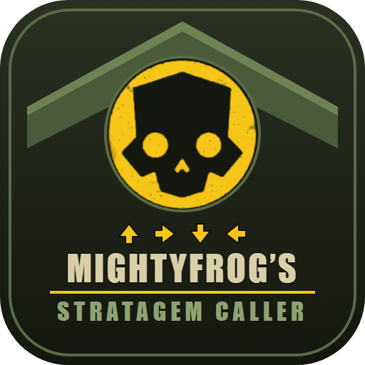

<div align="center">
  
  <h1>MightyFrOg's Stratagem caller</h1>
  <p>Fast, offline stratagem input from Android to Helldivers 2 on Windows.</p>
  <a href="https://github.com/N01-b4/mightyfrogs-stratagem-caller/actions/workflows/android.yml"></a>
</div>

## What it does

The Android app provides a landscape stratagem grid and sends the selected direction sequence over local Wi-Fi to the Windows receiver. The receiver injects keyboard input into the active Windows game. The personal loadout and mission-specific call-ins have separate selection lists.

### Package contents

- **Android:** `MightyFrOg's Stratagem caller` — Android 11/API 30 or newer.
- **Windows:** `MightyFrOg's Stratagem Reciver` — self-contained x64 executable for Windows 11 PC or Steam Deck.
- **Default keys:** hold Left Ctrl; arrow keys for Up, Down, Left, Right.
- **Default input timing:** 55 ms key-down, with a 25 ms gap between arrows.

> **Important:** This is keyboard automation, not a virtual Xbox controller. Configure Helldivers 2 to use the matching stratagem key bindings. The Windows receiver must run on the same Windows device as the game.

## Download and setup

Download the latest APK and Windows receiver from the [GitHub Releases](https://github.com/N01-b4/mightyfrogs-stratagem-caller/releases) page, or use the combined `MightyFrOg-Stratagem-Caller-v1.3.0.zip` package.

1. Install the APK on the Android phone. Android may ask you to allow installation from the browser or file manager used to open it.
2. On the Windows 11 PC or Steam Deck running the game, extract and launch `MightyFrOg's Stratagem Reciver.exe`.
3. Keep the receiver running, open the caller app, and approve the receiver once.
4. Confirm the game uses Left Ctrl plus the arrow keys for stratagem entry. Change the mapping in **Settings** if needed.
5. Tap a stratagem tile. Hold **STOP**/tap **STOP** to cancel; held inputs are released when the sequence ends or the link closes.

The receiver discovers the phone on the local network and connects outward; no Windows inbound firewall rule, address entry, or PIN is required. Both devices must be on the same Wi-Fi network with local device-to-device traffic enabled. Guest networks, VPNs, or router client isolation may block discovery.

## Timing and reliability

The default 55 ms key-down pulse and 25 ms inter-key gap are tuned to provide distinct input edges while keeping a nine-direction sequence under one second before local-network acknowledgements. Existing installs using the older 40 ms or 90 ms defaults migrate to 55 ms. Increase **Arrow hold time** in Settings if the game drops inputs; very short pulses may be missed by the game's input polling.

The Windows receiver uses the Windows `SendInput` API and marks arrow keys as extended keys. It reports input-injection failures instead of silently treating them as successful.

## Stratagem catalog

The offline catalog currently contains 119 entries, including 20 mission-specific call-ins. Direction codes, source labels, and catalog entries are transcribed from the [Helldivers Wiki stratagem tables](https://helldivers.wiki.gg/wiki/Stratagems). The app does not download the catalog at runtime.

Refresh and validate the catalog on Windows:

```powershell
powershell.exe -NoProfile -ExecutionPolicy Bypass -File .\scripts\refresh_catalog.ps1
powershell.exe -NoProfile -ExecutionPolicy Bypass -File .\scripts\validate_catalog.ps1
```

The validator checks entry identifiers, codes, permanent stratagem sequences, and that only Mission-category entries are marked as mission-specific. Catalog data can change as the game changes; report mismatches with the game version and the affected stratagem.

## Build from source

Requirements: JDK 17, Android SDK Platform 35, .NET 8 SDK, and Windows for building the receiver icon/publish package.

```powershell
.\gradlew.bat testDebugUnitTest assembleRelease
dotnet publish windows-receiver\StratagemCaller.Receiver.csproj -c Release -r win-x64 --self-contained true /p:PublishSingleFile=true -o windows-receiver\publish
Rename-Item -LiteralPath "windows-receiver\publish\MightyFrOg-Stratagem-Reciver.exe" -NewName "MightyFrOg's Stratagem Reciver.exe"
powershell.exe -NoProfile -ExecutionPolicy Bypass -File .\scripts\test_receiver.ps1
```

The APK is signed with the local Gradle debug key for sideload testing. It is not a Play Store signing key; keep the same key to install updates over an existing sideloaded copy. Do not distribute a release APK signed with the shared debug key as a production app.

## Project references

- [Helldivers Wiki — Stratagems](https://helldivers.wiki.gg/wiki/Stratagems) — offline catalog source.
- [Windows `SendInput` reference](https://learn.microsoft.com/windows/win32/api/winuser/nf-winuser-sendinput) — receiver keyboard injection API.
- [Android developer guide — app icons](https://developer.android.com/develop/ui/views/launch/icon_design_adaptive) — adaptive launcher icon behavior.
- [MIT License](LICENSE) — source code license.
- App branding assets in [`branding/`](branding/) were supplied for this project; see its README for artwork terms.

## Limitations and privacy

- The game and receiver must run on the same Windows device; the receiver does not control a separate console or another PC.
- This project sends keyboard input only. It does not create a virtual controller or bypass game input restrictions.
- The receiver communicates over the local Wi-Fi network and does not send telemetry or use a cloud service. The phone requires local network access for pairing and input.
- This is an unofficial fan-made utility and is not affiliated with Arrowhead Game Studios or Sony Interactive Entertainment. Helldivers 2 is a trademark of its owner.

## Contributing and support

Please include Android version, Windows version, game input bindings, receiver log output, and a reproduction sequence when reporting a connection or input issue. See [CONTRIBUTING.md](CONTRIBUTING.md) and [SUPPORT.md](SUPPORT.md).
